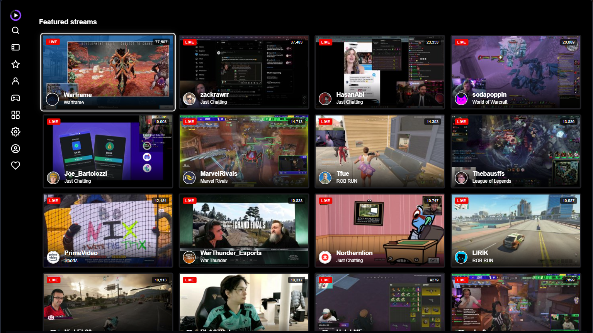
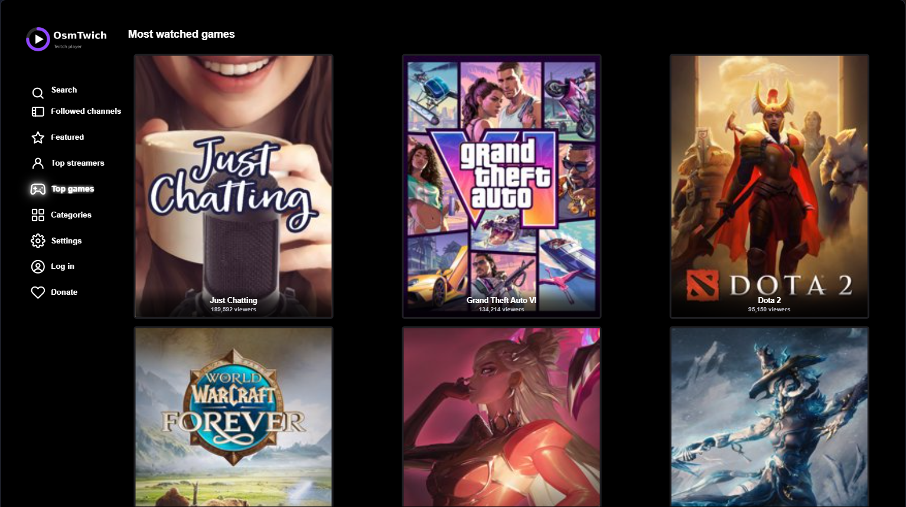
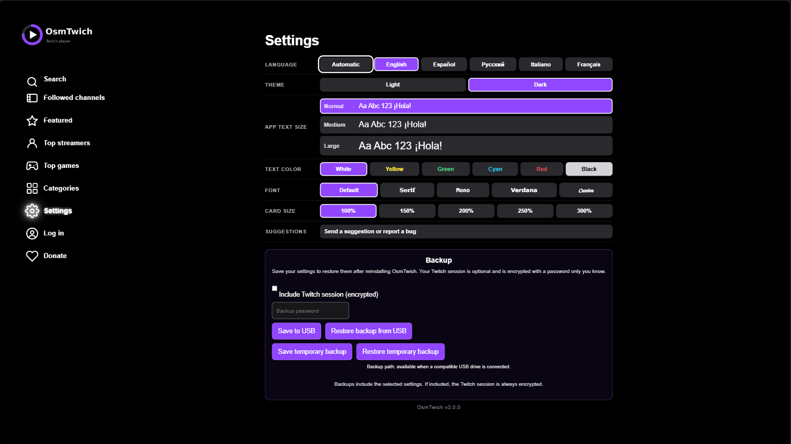
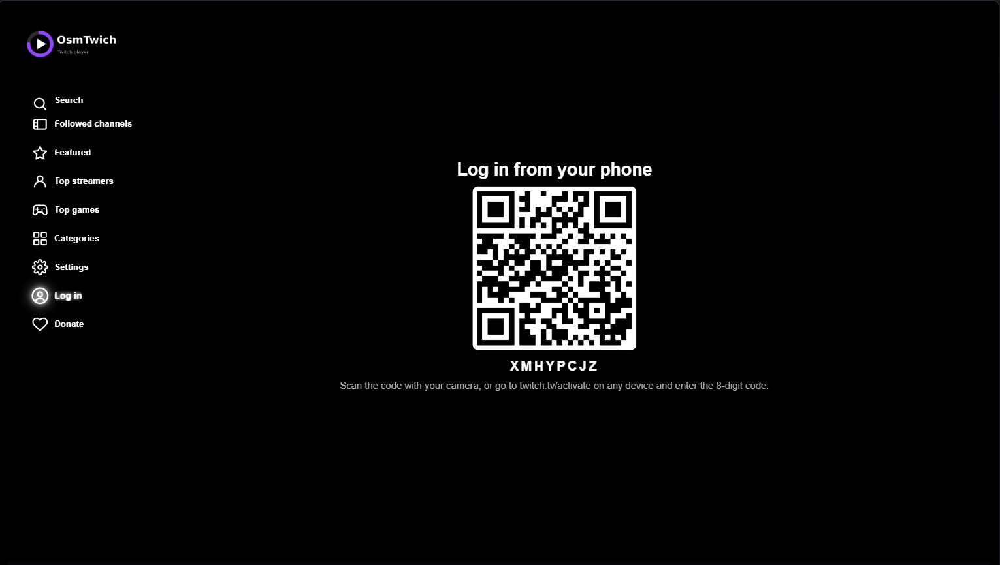
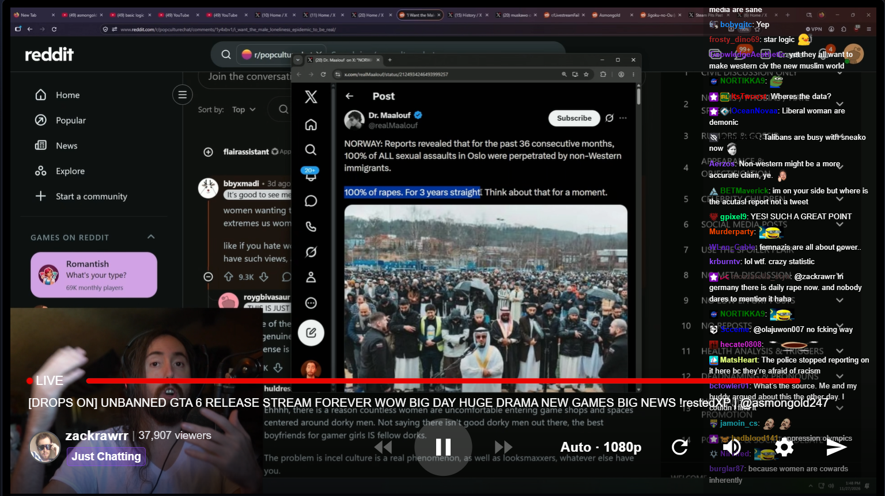
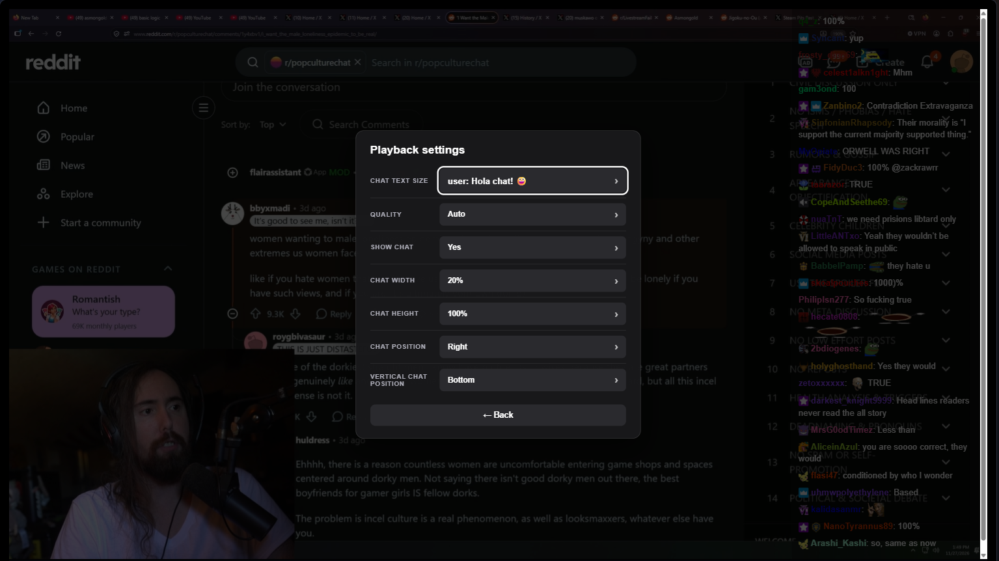
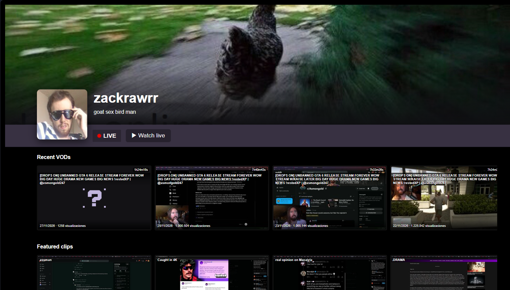
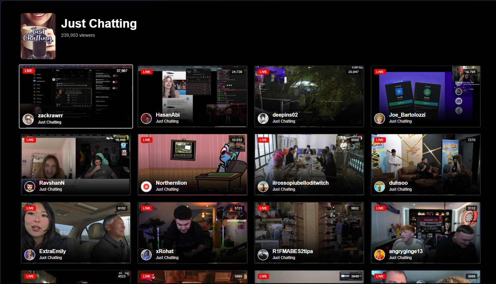

# OsmTwich

Unofficial Twitch client for Samsung Tizen TVs, Android TV, and web browsers. Designed and optimized for remote control navigation.

## Screenshots

| Featured streams | Most watched games | Settings | Login |
|---|---|---|---|
|  |  |  |  |

| Player | Playback settings | Channel profile | Just Chatting category |
|---|---|---|---|
|  |  |  |  |

## Features

- D-pad navigable sidebar
- Followed channels, featured streams, top streamers, and top games
- Player with autoplay, quality selection, and VOD seeking
- Built-in chat with Twitch, 7TV, BTTV, and FFZ emotes, real badges, and VOD chat replay
- Twitch login (redirect or QR code)
- Theme, text size, text color, and card size settings
- Player settings: video quality and chat size/position
- `perf-lite` mode for lower-end TVs

## Install on a TV

### Apps2Samsung catalog (recommended)

1. Install [Apps2Samsung](https://apps2samsung.com/) on your phone or computer ([GitHub](https://github.com/Apps2Samsung/Apps2Samsung))
2. Put the TV in **Developer Mode** and connect on the same network
3. In Apps2Samsung, open the catalog and install **Arn0+** (also listed in the [community packages](https://github.com/Apps2Samsung/tizen-community-packages) bundle)

Open **OsmTwich** from the Samsung app list. No manual `.wgt` download needed for normal installs.

### Manual `.wgt` (updates / offline)

1. Download the latest [**release `.wgt`](https://github.com/josepvarela/OsmTwichPlayer/releases)
2. Apps2Samsung → **Custom WGT** (signs on install)

## Development

The app is built in `index.html` (HTML + CSS + JavaScript, no frameworks). The serverless backend runs on Vercel (`/api/*`) and handles the Twitch token, session refresh (`/api/twitch-refresh`), and VOD comments proxy.

## License

This project is licensed under the [MIT License](LICENSE). You may use, copy, modify, and distribute it freely, provided that the copyright and license notice are included.

## Disclaimer

This project is not affiliated with or endorsed by Twitch or Samsung. Twitch, its emotes, and its logo are trademarks of Twitch Interactive, Inc.
